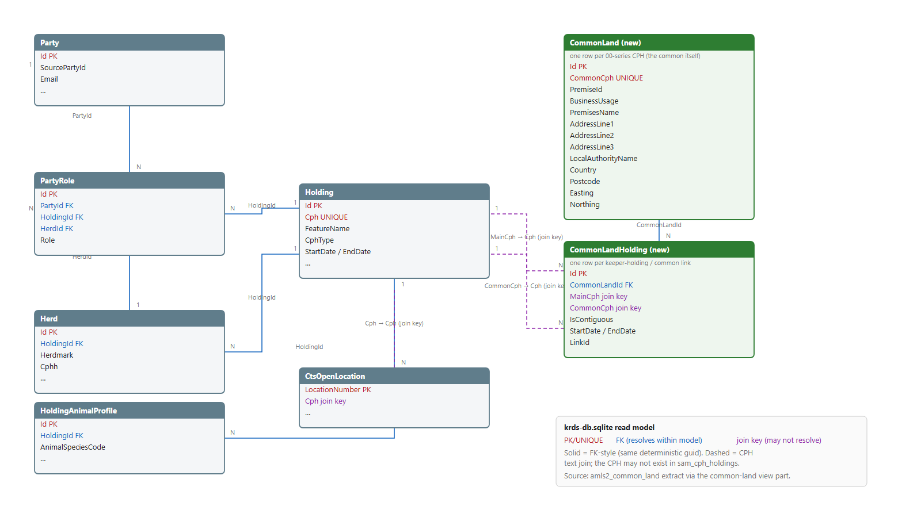
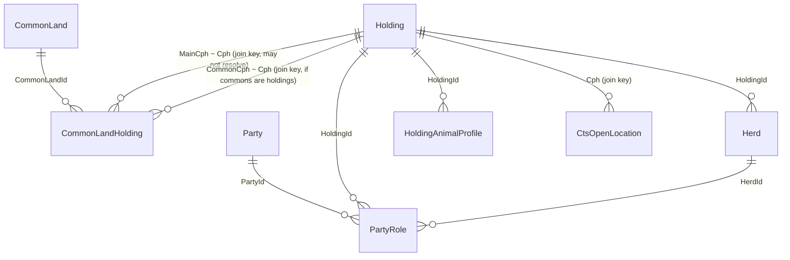

# Common Land in the ETL Pipeline — Read Model Design (parked)

> **Status:** Implemented and tested on a branch; parked pending business answers to the
> open questions below. Not merged.
>
> **Ticket:** draft written (see "Ticket draft" section) — create when work resumes.
> **Related:** LKPR-18 (sites endpoint contract), LKPR-295 (common land discovery epic).

## Why this exists

Common land is land registered with a Local Authority under the Commons Registration Act
1965 / Commons Act 2006. Where livestock graze it, the RPA allocates a **00-series CPH** to
the common (e.g. `00/000/8267`); keepers register to use it through AMLS (BCMS), which
records the link between the keeper's holding CPH and the common's CPH, including whether
the land is **contiguous** (stock walks on) or **non-contiguous** (stock is transported).

The long-term LIP direction is to align cattle with the sheep/goat process — movements
reported against the common's 00-series CPH rather than per-keeper workaround CPHs. That
requires trustworthy, consumable common-land link data.

## What we found

- The `amls2_common_land` extract (`litprd/LITP_AMLS2COMMONLAND_*`, delta feed, composite
  key `MAIN_CPH` + `COMMON_CPH`) was **already registered** in
  `StandardDataSetDefinitionsBuilder` and flowed end-to-end into the staging DuckDB.
- The gap was the final export: `SqliteViewDefinition.Parts` produced `Party`, `Holding`,
  `Herd`, `HoldingAnimalProfile`, `PartyRole`, `CtsOpenLocation` — **nothing surfaced
  common land** into `krds-db_*.sqlite` (served via `GET /api/etl/staging/sqlite/latest`).
- The downstream contract (LKPR-18): the sites endpoint answers **both** directions —
  `associatedMainHoldings` on a common site (join via `COMMON_CPH`) and
  `associatedCommonLands` on a holding (join via `MAIN_CPH`), each entry carrying
  `holdingIdentifier`, `contigousFlag`, `startDate`, `endDate`.

## The extract's real schema (confirmed from a sample file)

`LITP_AMLS2COMMONLAND_20251113121333.xlsx` — 8,630 rows, columns:

```
BATCH_ID, CHANGE_TYPE, COMMON_LAND_PREMISE_ID, MAIN_CPH, COMMON_CPH, BUSINESS_USAGE,
PREMISES_NAME, ADDRESS_LINE_1..3, LOCAL_AUTH_NAME, COUNTRY, POSTCODE, EASTING, NORTHING,
LINK_ID, CONTIGUOUS_COMMON, START_DATE, END_DATE
```

Findings that shaped the design:

- **`MAIN_CPH = '-'` on ~99.97% of rows** — the feed is predominantly a *register of
  commons*; keeper links are rare in the sample. → commons and links need separate tables.
- **`CONTIGUOUS_COMMON`** is the flag column (`Yes`/`No`).
- **`LINK_ID = -1`** is the "no link" sentinel (like `-` elsewhere).
- **`END_DATE = 31-DEC-2999`** is AMLS's permanent-link sentinel → we emit `NULL`.
- **`START_DATE`/`END_DATE`** appeared as Excel serials in the workbook (`40500`,
  `401768`); the transform accepts both serials and formatted dates.
- **`COMMON_LAND_PREMISE_ID`** is unique per common — AMLS's site id, surfaced as
  `PremiseId` (is it the Local Authority CL number? — open question).
- **`BUSINESS_USAGE = 'Common Land'`** throughout — likely the site-type field
  (quasi-commons?) — surfaced verbatim.

## The design

A new SQLite view part, `common-land` (embedded SQL, `required: false` — skipped where the
feed isn't loaded, like `cts-open-locations`), producing **two tables**:

```sql
CREATE TABLE CommonLand (                    -- one row per COMMON_CPH (the site)
    Id TEXT PRIMARY KEY,                     -- deterministic guid of CommonCph
    CommonCph TEXT NOT NULL UNIQUE,          -- 00-series CPH
    PremiseId INTEGER,                       -- COMMON_LAND_PREMISE_ID
    BusinessUsage TEXT,
    PremisesName TEXT,
    AddressLine1..3 TEXT,
    LocalAuthorityName TEXT,
    Country TEXT, Postcode TEXT,
    Easting INTEGER, Northing INTEGER
);

CREATE TABLE CommonLandHolding (             -- one row per MAIN_CPH↔COMMON_CPH link
    Id TEXT PRIMARY KEY,                     -- deterministic guid of the pair
    CommonLandId TEXT NOT NULL,              -- → CommonLand.Id (always resolves)
    MainCph TEXT NOT NULL,                   -- keeper holding CPH (join key, not FK —
    CommonCph TEXT NOT NULL,                 --   may not exist in sam_cph_holdings)
    IsContiguous INTEGER,                    -- 1 walks on / 0 transported / NULL unknown
    StartDate INTEGER, EndDate INTEGER,      -- epoch seconds; NULL = live
    LinkId TEXT
);
```





**Why two tables:** site attributes (name, address, authority) are properties of the
common, not of anyone's use of it — repeating them per link row risks conflicting values
with no principled winner. A common with no keeper is still a site (99.97% of the feed!).
Links reference `CommonLandId`, derived the same way as `CommonLand.Id`, so they always
resolve. `MainCph` stays a text join key (convention: `CtsOpenLocation.Cph`) — the keeper's
holding may not be in the SAM extract.

## What was built

| File | Change |
|---|---|
| `src/KeeperData.Core/EtlPipeline/Views/Sql/common-land.sql` | New view part (embedded) |
| `SqliteViewDefinition.cs` | `Part("common-land", ["amls2_common_land"], ["CommonLand","CommonLandHolding"], required:false)` |
| `KeeperData.Core.csproj` | EmbeddedResource entry |
| `tests/.../Views/CommonLandExtractFixture.cs` | Real-shaped staging fixture |
| `tests/.../Views/SamExtractFixture.cs` | `includeCommonLand` flag |
| `tests/.../Views/CommonLandTests.cs` | 22 tests: grain, joins, sentinels, serial/2999 dates, skip/absent-column |
| `tests/.../Views/DuckDbSqliteViewWriterTests.cs` | Updated table/index/count expectations |
| `docs/diagrams/` | ER diagram (SVG + PNG) + generator script |

**Verified:** full build clean; all ETL pipeline test filters green
(174 Infrastructure + 368 Core + 115 Views).

## Open questions for the business (blocking merge)

1. **Only 2 of ~8,600 rows had a keeper link** — is the extract primarily a register of
   commons? Where do the real keeper↔common links come through (another file? deltas?)?
2. Confirm sentinels: `-`/`''` = absent, `LINK_ID -1` = no link, `31-DEC-2999` = permanent.
   Any others?
3. Raw date format in the CSV feed (the workbook showed Excel serials)?
4. What values can `BUSINESS_USAGE` take — does it distinguish quasi-commons?
5. Is `COMMON_LAND_PREMISE_ID` the Local Authority CL number (CL1…)?
6. Do 00-series common CPHs exist as holdings in SAM/CTS, or is this feed the only place
   commons are described?
7. Do the cattle-workaround standard CPHs (non-contiguous) appear in this feed, and should
   consumers distinguish them?
8. When a registration ends, does the feed send an end date, a delete, or both?
   (Delta `D` rows are currently counted-and-skipped by the merge engine — pre-existing
   pipeline behaviour, not specific to common land.)
9. Does the LKPR-18 sites contract still stand under LIP, or has the target shape changed?
10. Who consumes these tables first, and when?

## To resume

1. Create the Jira ticket from the draft below and link it to LKPR-295.
2. Get business answers to Q1–Q9 (Q1 is the big one — if links are missing from this feed
   the whole projection is academic).
3. Adjust `common-land.sql` if the answers change column semantics; fixture + tests follow.
4. Merge when green.

### Ticket draft

**Keeper Data Bridge: Surface common land data in the krds-db read model**

> Add `CommonLand` + `CommonLandHolding` tables to the pipeline's SQLite export so KRDS
> can serve common-land associations on sites (LKPR-18) from the new pipeline rather than
> the legacy Mongo ingestion. The `amls2_common_land` extract already reaches staging;
> this adds a `common-land` view part (optional — skipped where the feed isn't loaded).
> Site table keyed on `COMMON_CPH` (+ `PremiseId`, `BusinessUsage`, name/address/geo);
> link table keyed on `MAIN_CPH`↔`COMMON_CPH` (+ `CommonLandId`, `IsContiguous`, epoch
> start/end, `LinkId`), indexed on both CPHs. Sentinels normalised (`-`,`''`,`,`→ NULL;
> `LINK_ID -1` → NULL; `31-DEC-2999` → NULL); serial-date tolerance; deterministic
> name-derived ids. Blocked pending business confirmation of feed coverage for keeper
> links — the sample was ~99.97% keeper-less commons.
